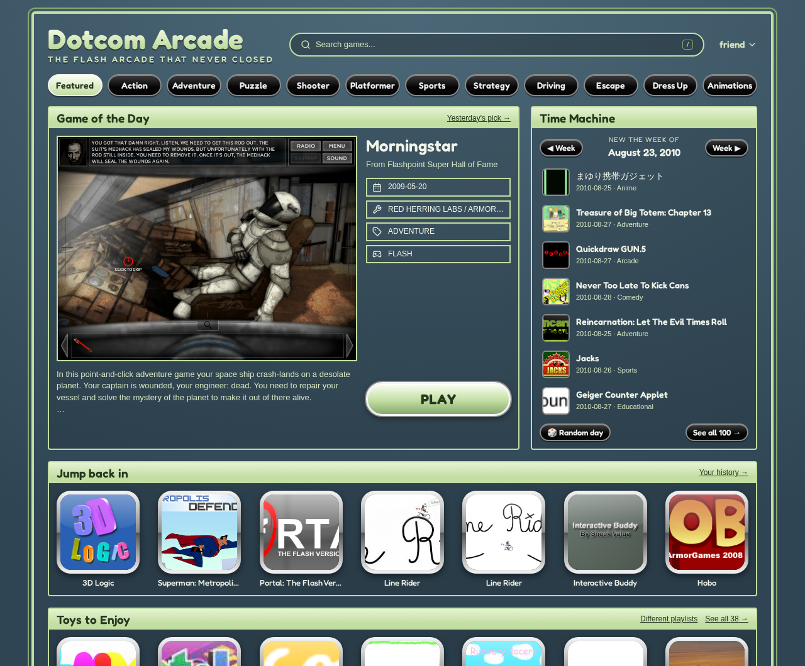
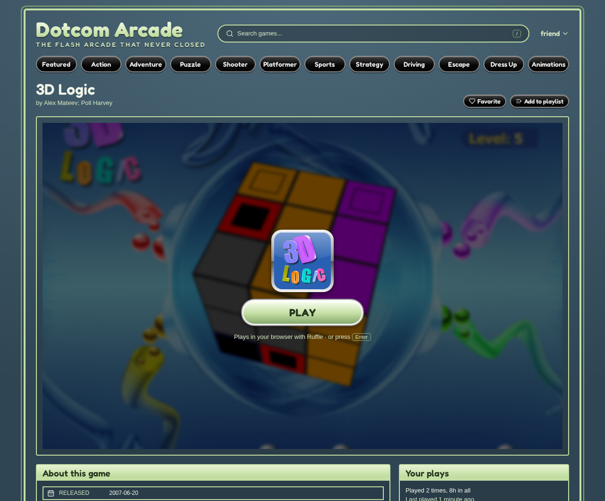
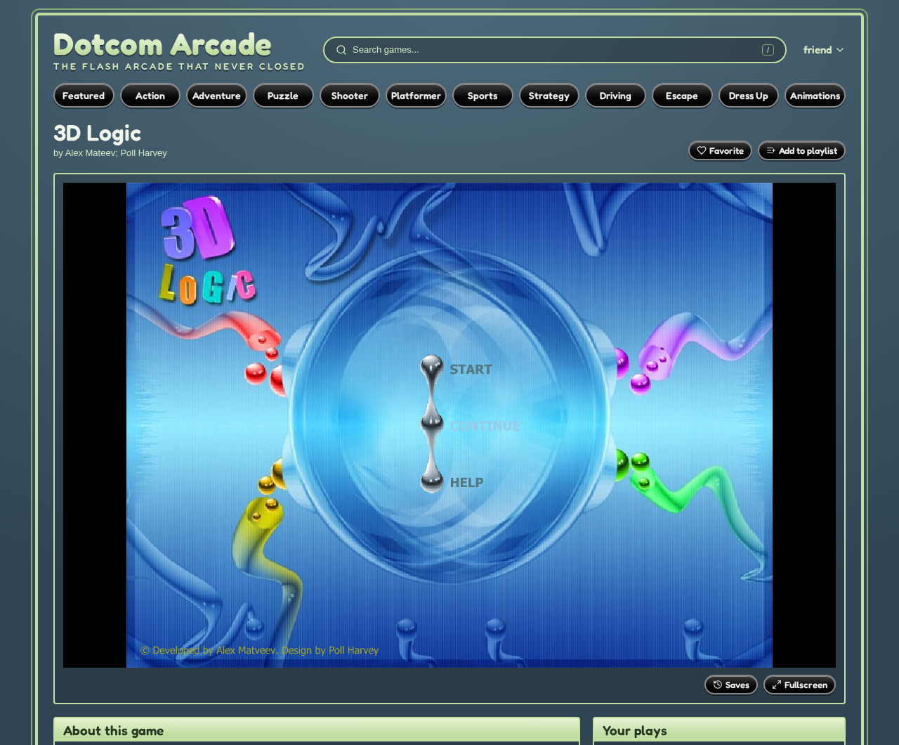

# Dotcom Arcade

**Your own Flash-era game portal, powered by
[Flashpoint Ultimate](https://flashpointarchive.org/).**

Dotcom Arcade serves a [Flashpoint Ultimate](https://flashpointarchive.org/)
collection as a website you'd have played at a friend's house or in the computer
lab, with modern UX. It aims to play as much of the archive as possible in any
browser: Flash and HTML5 run in the page, and Java, Shockwave and the original
Flash Player stream from your server.



> [!NOTE]
>
> Dotcom Arcade is an unofficial community project, not affiliated with
> Flashpoint Archive. It's built on
> [flashpoint-web](https://github.com/darkraise/flashpoint-web) by darkraise.

## Before you start: hosting requirements

> [!WARNING]
>
> **Dotcom Arcade needs a lot of disk, and streaming needs a lot of CPU.** Check
> these before you download anything.

| Resource      | Needed                                                                                                                                                                                                                       |
| ------------- | ---------------------------------------------------------------------------------------------------------------------------------------------------------------------------------------------------------------------------- |
| **Storage**   | **More than 2.3 TB** for Flashpoint Ultimate 14, and growing with each release. 4.6 TB if you keep the downloaded archives to seed them. A spare desktop drive won't do.                                                     |
| **Time**      | A day or more to download and extract, depending on your connection and disks.                                                                                                                                               |
| **Server**    | Linux with Docker. 2 CPU cores and 4 GB of RAM serve the site and in-browser games to a household.                                                                                                                           |
| **Streaming** | Optional, and heavy: every player gets their own container running the game and encoding its video on the CPU. Plan on roughly 1 to 2 CPU cores and 1 GB of RAM per player streaming at once, and a few Mbps of upload each. |
| **HTTPS**     | Required for streaming, since browsers only allow its video decoder on secure pages. Recommended anyway.                                                                                                                     |

## Features

- **Plays almost everything.**
  - Flash runs in [Ruffle](https://ruffle.rs/) and HTML5 runs natively.
  - Games no browser can run stream from the server into the page, each player
    in their own container: Java applets, Shockwave and Director games, and
    Flash games that need the real Flash Player. With streaming on, any Flash
    game can switch to the original Flash Player.
- **An arcade, not a file browser.** A portal-style layout with genre categories
  and glossy tiles, and color schemes defined as data, so new themes are easy to
  add.
- **Discovery first.** The homepage offers:
  - a Game of the Day;
  - a Time Machine of games released in any week, with a date picker;
  - shelves from Flashpoint's curated playlists;
  - your recently played games.

  Browse lists default to a shuffle, not A to Z.

- **One page per game.** It has a click-to-play stage, details and tags, and
  related games ranked by shared tags, series and developer.
- **Accounts and saves.**
  - Multi-user, with roles.
  - Favorites, playlists and play tracking.
  - Game saves follow you between browsers, with the last 10 kept as backups.
- **Sign in through your proxy.** Authentik, Authelia, oauth2-proxy and similar
  forward-auth proxies can sign users in.
- **Mature content filter.** Adult and extreme content is hidden unless a user
  opts in.

<p align="center">
  
  
</p>

## Getting started

Check the [hosting requirements](#before-you-start-hosting-requirements) first.

### 1. Get Flashpoint Ultimate

Download two files from Flashpoint's
[downloads page](https://flashpointarchive.org/downloads):

- the **Flashpoint Ultimate** `.torrent` file;
- **Flashpoint Infinity for Linux** (`.7z`), whose software streaming needs.

[`scripts/setup-flashpoint.sh`](scripts/setup-flashpoint.sh) then does the rest:

- It checks that you have the disk space, and stops before downloading anything
  if you don't.
- It downloads the torrent with `aria2c`.
- It extracts each archive in turn and deletes it afterwards, so the disk never
  needs room for both.
- It pulls the database, settings and playlists out of `Base_1.zip`, which
  otherwise only holds Windows software.

Re-run it to resume after an interruption.

```sh
sudo apt install aria2 7zip tmux
tmux new -s flashpoint
scripts/setup-flashpoint.sh --torrent FlashpointUltimate14.torrent \
  --infinity fp14.0.3_lin_20251201.7z /srv/flashpoint
```

`--keep-archives` keeps the archives so you can keep seeding, which needs room
for both copies.

### 2. Configure

```sh
cp .env.example .env
```

Set at least these:

```sh
FLASHPOINT_HOST_PATH=/srv/flashpoint
JWT_SECRET=<output of: openssl rand -hex 32>
PUID=1000                             # your user, from `id -u` and `id -g`
PGID=1000
```

### 3. Start

```sh
docker compose up -d --build
```

Open `http://<server>/` and create the admin account. On first start the app
indexes the collection, which takes a few minutes on a full Ultimate install.
Under **Settings → App** you can set the site name and tagline.

### 4. Optional: streaming

Streaming plays the games browsers can't. To turn it on:

1. Run the setup script with `--infinity`.
2. Add to `.env`:

   ```sh
   COMPOSE_PROFILES=streaming
   STREAMING_API_TOKEN=<output of: openssl rand -hex 32>
   ```

3. Rebuild with `docker compose up -d --build`.
4. Serve the site over HTTPS. The app proxies streams itself, so your reverse
   proxy only needs to pass WebSocket upgrades and allow long-lived connections.
   See the [streaming guide](docs/10-features/13-streaming.md).

The session manager starts containers through the Docker socket, which amounts
to root on the host. It publishes no ports: only the app talks to it.

### Signing in through a reverse proxy

If your site sits behind Authentik, Authelia or another forward-auth proxy, the
app can trust the username it passes along. See
[proxy sign-in](docs/10-features/14-proxy-sign-in.md).

## Updating

```sh
git pull
docker compose up -d --build
```

## Documentation

The [docs](docs/README.md) cover features, deployment, configuration, the API
and development. Useful starting points:

- [Environment variables](docs/09-deployment/environment-variables.md)
- [Discovery portal](docs/10-features/12-discovery-portal.md)
- [Streaming](docs/10-features/13-streaming.md) and
  [streaming internals](streaming/README.md)
- [Development setup](docs/08-development/setup-guide.md)

## Credits

- [Flashpoint Archive](https://flashpointarchive.org/), for preserving web games
  and animations, and for the curated playlists the homepage draws on.
- [flashpoint-web](https://github.com/darkraise/flashpoint-web) by darkraise,
  which this project is built on.
- [Ruffle](https://ruffle.rs/), for running Flash in modern browsers.
- [Selkies](https://github.com/selkies-project/selkies), which streams the
  games.

## Legal

Flashpoint Archive is a preservation project whose legal standing has never been
settled. It removes games when their rights holders ask. Dotcom Arcade contains
no games and links to no game downloads. You get Flashpoint from Flashpoint's
own site, and you are responsible for complying with copyright law where you
live. Rights holders who want a game removed should contact
[Flashpoint Archive](https://flashpointarchive.org/).

## License

GPL-3.0, like flashpoint-web. See [LICENSE](LICENSE).
